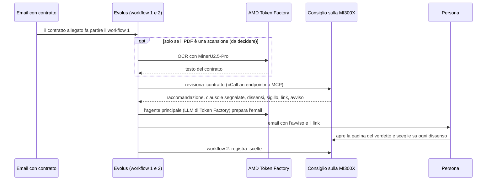

# Il flusso del Consiglio silenzioso, da capo a fondo

Come gira il Consiglio dal contratto che arriva alla scelta della persona, e chi fa cosa.
Deciso il 13/10/2026. Cambia una cosa rispetto a: **l'agente principale in Evolus usa un modello di AMD Token Factory**, non il nostro vLLM sul droplet (vedi "Cosa cambia").

## In una riga

Evolus riceve il contratto, il Consiglio sulla MI300X lo esamina in telepatia, la persona decide sulla pagina del verdetto; Vercel è solo la vetrina per i giudici.

## Chi fa cosa

| Pezzo | Dove gira | Cosa fa | Stato |
|---|---|---|---|
| **Consiglio silenzioso** (il cuore) | server sulla MI300X (`consiglio/servizio`) | esamina il contratto con gli esperti in telepatia; espone `revisiona_contratto` e `registra_scelte` via MCP e HTTP | fatto, 16 test |
| **Eval pre-registrato** | MI300X | i numeri per la giuria: telepatia contro testo, agente solo, voto fra 4, su CUAD, ContractNLI e CLAUDETTE | in corso |
| **Workflow 1 in Evolus** | Evolus | parte dall'email, chiama il Consiglio, manda l'avviso alla persona | da fare |
| **Agente principale** | Evolus, con un LLM di **Token Factory** | scrive l'email per la persona partendo dall'avviso del Consiglio; **non** decide l'esito e **non** rilegge il contratto | da fare |
| **Pagina del verdetto** | server del Consiglio | raccomandazione, 19 righe, dissensi, sigillo; la persona sceglie "esperto" o "verdetto" | fatta |
| **Workflow 2 in Evolus** | Evolus | riporta le scelte della persona con `registra_scelte` | da fare |
| **Vetrina** | Vercel (`casa/`) | il link per i giudici: casi registrati, prova dal vivo quando la MI300X è accesa, numeri dell'eval | in parte |

## Vercel non riceve email

Vercel è la **vetrina per i giudici**, non l'ingresso dei contratti: le email arrivano solo in Evolus.
Su Vercel ci sono pagine statiche sempre accese e due funzioni che tengono le chiavi (quella del server e quella di Evolus), mai nel browser.

## Perché niente LLM as judge sul documento intero

Un LLM che rilegge tutto il contratto a testo rifà il lavoro del Consiglio, e confonde il messaggio che portiamo ai giudici: la telepatia è diversa dal testo.
Il confronto con un solo agente e con il voto fra 4 c'è già, nell'eval.

## Cosa cambia rispetto a 

- **Prima:** l'agente principale usava Qwen3.6-35B-A3B sul nostro vLLM, perché la track chiede *"an open model served on AMD infrastructure through your own vLLM endpoint on AMD Developer Cloud"*.
- **Ora:** l'agente usa un modello di **Token Factory**, l'API di AMD presentata al kickoff del 12/10. Così il progetto usa **Token Factory e la GPU**, come chiesto in chat per l'eleggibilità (`QeA/chat-discord-act3-domande-e-risposte.md`, §1).
- **Da confermare con i mentor** che Token Factory valga per quel requisito della track. Domanda da fare su Discord:
  > @Mentors For the Evolus track: can the main agent's LLM be a Token Factory model, or must it be our own vLLM endpoint on AMD Developer Cloud?

## Ancora aperto

- La risposta dei mentor sul modello dell'agente.
- Se aggiungere l'**OCR di Token Factory** per i contratti scansionati: oggi il server li rifiuta.
- Chi fa partire il **workflow 2**: la pagina del verdetto è servita dal server del Consiglio, mentre nello Sportello lo avvia una funzione di Vercel (`casa/api/decisione.mjs`).
- Il PDF passa da MCP o da «Call an endpoint»: nello Sportello solo il secondo funziona, per il Consiglio non è ancora provato.

Guida di Token Factory: `QeA/tokenfactory-guide.pdf`.
