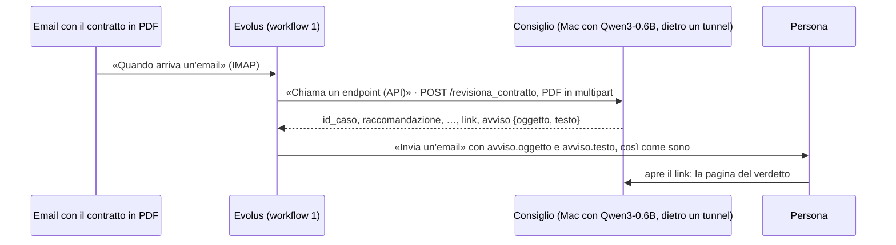

# consiglio/evolus: il workflow 1 in Evolus

Codice e guida, il lato Evolus.
È la prima fetta: dall'email con il contratto all'avviso per la persona, **senza agente e senza GPU**.
Il flusso intero è in `consiglio/FLUSSO.md`; il server è in `consiglio/servizio`.



I nomi fra «» sono quelli dell'interfaccia di Evolus in italiano, visti nella workspace dell'evento il 14/10.

## 0. Il server, raggiungibile da Evolus

Evolus vuole un indirizzo pubblico in https e rifiuta quelli privati. Il server gira sulla MI300X, nel container del motore di G1 (`g1/README.md`, passo 3), con il torch ROCm dell'immagine; su un Mac da 8 GB non regge.

```bash
# sulla MI300X: il codice di main in ~/hackathon/eval, che nel container è /work/eval
docker exec motore bash -c "cd /work/eval/consiglio/servizio && python3 -m venv --system-site-packages /root/venv \
    && grep -v '^torch==' requirements.txt > /tmp/req.txt && /root/venv/bin/pip install -r /tmp/req.txt"

# il tunnel: stampa https://<nome>.trycloudflare.com
cloudflared tunnel --url http://127.0.0.1:8001

# il server, con quel nome; lo stesso segreto va nel webhook di Evolus
export CONSIGLIO_SEGRETO=$(openssl rand -hex 32)
NOME=<nome>.trycloudflare.com
docker exec -d -e CONSIGLIO_SEGRETO -e NOME motore bash -c "cd /work/eval/consiglio/servizio && \
    /root/venv/bin/python -m revisore --modello Qwen/Qwen3-14B --passi 10 \
    --link https://\$NOME/verdetto/{id}?chiave={chiave} --host-pubblico \$NOME"
```

`curl https://$NOME/salute` deve rispondere `"pronto": true`.
Una macchina nuova ha un IP nuovo e il tunnel un nome nuovo: si aggiorna l'URL del webhook «Consiglio» in Evolus.
Il nome fisso è in `casa/mi300x/README.md`, "Il nome del motore", ancora da configurare.

## 1. L'automazione

«Automazioni» › «+ Nuova automazione»: `Consiglio – contratto dall'email`. Resta **«In pausa»** finché il giro non è provato.

### «Quando parte»

- **«Quando arriva un'email»**, «Tipo di casella» **IMAP** (c'è anche Microsoft 365 con Graph, che chiede un'app su Azure):
  `imap.gmail.com`, porta 993, SSL, utente l'indirizzo completo, password **per le app** di Google.
  Google non dà la password per le app agli account appena creati: serve un account più vecchio.
- **La casella dei contratti è diversa da quella che riceve gli avvisi**, altrimenti ogni avviso farebbe ripartire l'automazione.
- **L'indirizzo pubblico è un altro account Gmail**, che inoltra a `<casella>+contratti@gmail.com`, perché un account nuovo non ha la password per le app:

  ```text
  contratto → indirizzo pubblico ──inoltro──▶ <casella>+contratti ──filtro──▶ cartella «Contratti» ◀── Evolus (IMAP)
  ```

  - nell'indirizzo pubblico: «Inoltro e POP/IMAP» › «Inoltra una copia della posta in arrivo a…», poi «Salva modifiche»; un filtro `filename:pdf` › «Non inviare mai a Spam», perché **Gmail non inoltra la posta finita nello spam** e i PDF da indirizzi nuovi ci finiscono;
  - nella casella: un filtro con «Contiene le parole» `deliveredto:<casella>+contratti@gmail.com` › «Ignora Posta in arrivo», etichetta `Contratti`, «Non inviare mai a Spam». Con il campo «A» non va: l'email inoltrata ha ancora come destinatario l'indirizzo pubblico;
  - Evolus legge solo le email **non lette**: il filtro non le segna come lette;
  - chi prova non manda dalla casella stessa: Gmail scarta la copia che torna indietro.
- «Ogni quanti secondi»: 120 di default. «Segna le email come lette» acceso; «Immagini nel corpo dell'email» escluse.
- «Se arrivano più documenti insieme»: **«Un giro per ogni documento»**, perché il server esamina un contratto per chiamata.
- **«Provala»** fa partire l'automazione a mano anche in pausa, con un PDF caricato: è la prima prova, senza email.

### «Cosa fa» › «Editor a tutto schermo»

```text
Partenza ──DOCUMENTO──▶ «Leggi il documento» ──▶ «Chiama un endpoint (API)» ──▶ «Invia un'email»
                        «Solo testo», gratis «Chiama il Consiglio» «Invia l'avviso al destinatario»
```

La tela si può montare a mano o con **«Costruisci con Evo»**, l'assistente di Evolus, che aggiunge e collega i blocchi.

**In Evolus un endpoint riceve solo testo, mai un file** (provato il 16/10):
- la Partenza ha due uscite, TESTO (il corpo dell'email) e DOCUMENTO (gli allegati); DOCUMENTO si collega solo a «Leggi il documento» e «Chiama un estrattore dati»;
- «Multipart coi file del flusso» collegato a TESTO non allega il PDF: manda un modulo con il solo testo, vuoto se si parte da «Provala»;
- quindi il PDF passa da **«Leggi il documento»** con il lettore **«Solo testo del documento»**, gratis, e il server riceve il testo nella parte `body` del modulo. È lo stesso testo che il server leggerebbe dal PDF; le scansioni restano vuote anche qui.

Gli altri lettori (Azure Document Intelligence, GreenPT, «Lascia fare a Evolus») costano 10 crediti a pagina. Servono solo per i contratti scansionati: è una fetta successiva.
In «Leggi il documento»: «I documenti sono facoltativi» spento (senza PDF il giro si ferma lì, senza chiamare il Consiglio), «Salta gli allegati non leggibili» acceso.

### «Chiama il Consiglio» (blocco «Chiama un endpoint (API)»)

| Campo | Valore |
|---|---|
| «Metodo» | `POST` |
| «Destinazione» | «Endpoint del catalogo», il collegamento con indirizzo e segreto cifrato |
| «Intestazioni (header)» | nessuna: lì il valore resta in chiaro, il segreto va nel collegamento del catalogo |
| «Corpo» | «Il risultato del flusso»: il testo letto dal PDF |
| «Formato di invio» | «Multipart coi file del flusso» |
| «Come leggere la risposta» | JSON |
| «Struttura della risposta (facoltativa)» | `risposta-esempio.json`, così il blocco dopo offre i campi |

Il collegamento del catalogo si crea da menu dell'azienda › «Sviluppatori» › «Webhook» › «Nuovo webhook», e appartiene all'applicazione dell'automazione, altrimenti la tendina non lo propone:

| Campo | Valore |
|---|---|
| «Nome» | `Consiglio` |
| «URL» | `https://<nome>/revisiona_contratto` |
| «Header di sicurezza» | `X-Api-Key` |
| «Valore segreto» | `CONSIGLIO_SEGRETO`, così com'è |
Il segreto sta solo lì, mai in un file del repo.

- **Il contratto:** il server prende un PDF (il campo `contratto` o il primo file che è un PDF, anche senza nome) e, se non c'è, il testo della parte `body` o di una parte senza nome, come lo manda Evolus. I campi in più si ignorano.
- **Mittente, oggetto e data** nell'indirizzo, se il collegamento accetta i segnaposto: `…/revisiona_contratto?mittente=…&oggetto=…`.
  Se mancano, il caso si esamina lo stesso, con mittente "(sconosciuto)" e la data di oggi; il titolo del verdetto è allora la prima riga del contratto.
- `modalita` resta quella di default, `telepatia`.

### «Invia l'avviso al destinatario» (blocco «Invia un'email»)

| Campo | Valore |
|---|---|
| destinatario | fisso: la persona che decide |
| «Rispondi a chi ha scritto» | **spento**: l'avviso non va mai a chi ha mandato il contratto |
| oggetto | `avviso.oggetto` della risposta di «Chiama il Consiglio» |
| testo | `avviso.testo` della stessa risposta, così com'è |

L'avviso lo scrive il server, con raccomandazione, clausole segnalate, dissensi in evidenza e il link alla pagina del verdetto.
Senza sigillo integro chiede una persona.

## Cosa manda e cosa riceve

- **Manda:** il PDF in multipart, `mittente`, `oggetto` e `data` nell'indirizzo.
- **Riceve:** `id_caso`, `verdetto`, `raccomandazione` {valore, motivazione}, `segnalate`, `dissensi_gravi`, `altri_dissensi`, `sigillo_integro`, `link`, `avviso` {oggetto, testo}, `modalita`, `token_generati`, `secondi`.
- **Usa:** solo `avviso.oggetto` e `avviso.testo`. Gli altri campi servono alla fetta con l'agente e al workflow 2.

Gli errori: 401 senza segreto, 400 con una richiesta sbagliata (per esempio una scansione senza testo), 500 con un guasto.

## Il tempo della chiamata e il nuovo tentativo

Misurato il 16/10 sulla MI300X, con Qwen3-14B e un contratto di una pagina:
- **la chiamata dura circa 105 secondi ed Evolus aspetta**, senza timeout;
- **la stessa email è lo stesso caso:** la seconda chiamata uguale torna in meno di un secondo, con lo stesso `id_caso`;
- **Evolus riprova da solo dopo un 500**, più volte (dopo circa 2, 11 e 30 secondi); **dopo un 400 non riprova**.

## Prova senza Evolus

```bash
curl -X POST "https://$NOME/revisiona_contratto?mittente=legal%40acme.example&oggetto=Contratto%20Acme&data=2026-10-14" \
    -H "Authorization: Bearer $CONSIGLIO_SEGRETO" -F "file=@contratto.pdf;type=application/pdf"
```

Rifatta uguale, torna lo stesso `id_caso` subito.

## Ancora aperto

- Il limite sugli allegati della casella.
- Dove si crea il collegamento del catalogo e se il suo indirizzo accetta segnaposto.
- Il timeout di «Chiama un endpoint» e se Evolus riprova da solo.
- Se la workspace dell'evento ha il connettore MCP proprio: serve alla fetta successiva.
