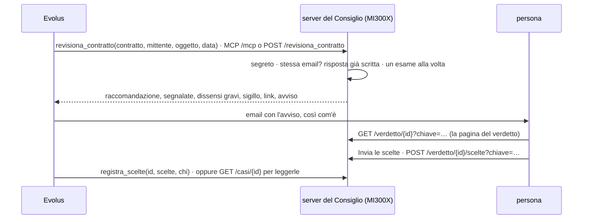

# consiglio/servizio: il Consiglio per Evolus

Codice, la parte "flusso Evolus".
Il server espone il Consiglio con due tool, via MCP e via HTTP, con lo stesso schema del server dello Sportello.
Così Evolus parla con i due progetti nello stesso modo.



| File | Cosa fa |
|---|---|
| `revisore/gestore.py` | i due tool e le loro regole, uguali per MCP e HTTP |
| `revisore/server.py` | MCP su `/mcp`, le stesse rotte in HTTP, il segreto, le rotte della persona con la chiave del link |
| `revisore/__main__.py` | carica Qwen3 una volta, crea il Consiglio in telepatia e a testo, avvia uvicorn |
| `tests/` | 16 test con un Consiglio finto, che restituisce la revisione d'esempio della pagina |

## Regole

- **Segreto:** tutte le rotte di Evolus lo chiedono, in `Authorization: Bearer <segreto>` oppure `X-Api-Key`.
- **Link della persona:** la pagina del verdetto e l'invio delle scelte usano la **chiave del caso**, un HMAC dell'id fatto con il segreto. Chi ha il link apre solo quel caso, senza conoscere il segreto. Con una chiave sbagliata o un caso che non esiste la risposta è sempre 404.
- **Un esame alla volta**, perché la GPU è una.
- **La stessa email è lo stesso caso:** il nuovo tentativo di Evolus non fa rigirare il Consiglio.
- **Senza sigillo integro** non c'è verdetto: `verdetto` è falso e l'avviso chiede una persona.
- **Il contratto** arriva come testo, in base64 o come file PDF in un modulo. Del PDF si legge il testo; una scansione senza testo viene rifiutata, perché l'OCR non c'è. **Il testo non si salva:** nel caso restano revisione, vista, pagina e scelte, più l'impronta del contratto.
- **Le scelte:** per ogni categoria in dissenso, `esperto` oppure `verdetto`, come i due bottoni della pagina.
- **Gli errori:** una richiesta sbagliata torna 400 prima di toccare il modello; un guasto torna 500 senza dettagli.

## Uso

```bash
cd consiglio/servizio
uv venv -p 3.12.venv && uv pip install -p.venv/bin/python -r requirements.txt
.venv/bin/python -m pytest -q # 16 test, senza modello

export CONSIGLIO_SEGRETO=$(openssl rand -hex 32) # lo stesso va nel connettore di Evolus
.venv/bin/python -m revisore --modello Qwen/Qwen3-14B --passi 10 \
    --link "https://consiglio.example.org/verdetto/{id}?chiave={chiave}" --host-pubblico consiglio.example.org
```

Il TLS lo fa Caddy davanti, come per lo Sportello: `caddy reverse-proxy --from consiglio.example.org --to 127.0.0.1:8001`.
I casi stanno in `~/.consiglio/casi/<id>/`.

## Cosa manca

- **Il lato Evolus:**
  - il workflow che parte dall'email e chiama `revisiona_contratto`;
  - l'avviso alla persona;
  - il secondo workflow con le scelte.

  Si fanno con l'integrazione Evolus e le risposte del Discord sui limiti del connettore.
- **Passi latenti e riallineamento** di `--passi` e `--senza-riallineamento`: quelli scelti, dopo la diagnosi.
