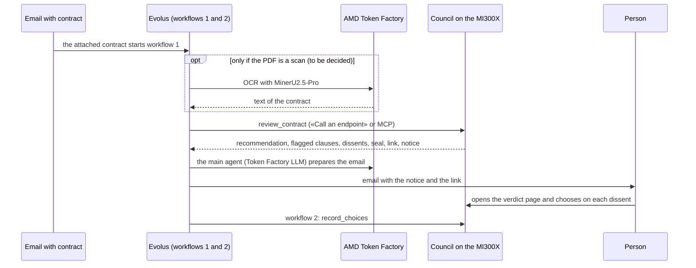

# The flow of the Silent Council, end to end

How the council runs from the incoming contract to the person's choice, and who does what.
Decided on 13/10/2026. It changes one thing compared to the previous plan: **the main agent in Evolus uses an AMD Token Factory model**, not our vLLM on the droplet (see "What changes").

## In one line

Evolus receives the contract, the council on the MI300X reviews it in telepathy, the person decides on the verdict page; Vercel is only the showcase for the judges.

## Who does what

| Piece | Where it runs | What it does | Status |
|---|---|---|---|
| **Silent Council** (the core) | server on the MI300X (`council/service`) | reviews the contract with the experts in telepathy; exposes `review_contract` and `record_choices` over MCP and HTTP | done, 16 tests |
| **Pre-registered eval** | MI300X | the numbers for the jury: telepathy against text, solo agent, vote among 4, on CUAD, ContractNLI and CLAUDETTE | in progress |
| **Workflow 1 in Evolus** | Evolus | starts from the email, calls the council, sends the notice to the person | to do |
| **Main agent** | Evolus, with a **Token Factory** LLM | writes the email for the person starting from the council's notice; it does **not** decide the outcome and does **not** reread the contract | to do |
| **Verdict page** | council server | recommendation, 19 rows, dissents, seal; the person chooses "expert" or "verdict" | done |
| **Workflow 2 in Evolus** | Evolus | reports the person's choices with `record_choices` | to do |
| **Showcase** | Vercel (`site/`) | the link for the judges: recorded cases, live review when the MI300X is on, eval numbers | partly |

## Vercel does not receive emails

Vercel is the **showcase for the judges**, not the entry point for contracts: emails arrive only in Evolus.
On Vercel there are static pages that are always on and two functions that hold the keys (the server's and Evolus's), never in the browser.

## Why no LLM as judge on the whole document

An LLM that rereads the whole contract as text redoes the council's work, and muddles the message we bring to the judges: telepathy is different from text.
The comparison with a solo agent and with the vote among 4 is already there, in the eval.

## What changes

- **Before:** the main agent used Qwen3.6-35B-A3B on our vLLM, because the track asks for *"an open model served on AMD infrastructure through your own vLLM endpoint on AMD Developer Cloud"*.
- **Now:** the agent uses a **Token Factory** model, the AMD API presented at the kickoff on 12/10. This way the project uses **Token Factory and the GPU**, as asked in the chat for eligibility (`QeA/chat-discord-act3-domande-e-risposte.md`, §1).
- **To be confirmed with the mentors** that Token Factory counts for that track requirement. Question to ask on Discord:
  > @Mentors For the Evolus track: can the main agent's LLM be a Token Factory model, or must it be our own vLLM endpoint on AMD Developer Cloud?

## Still open

- The mentors' answer on the agent's model.
- Whether to add the **Token Factory OCR** for scanned contracts: today the server rejects them.
- Who starts **workflow 2**: the verdict page is served by the council server, while in the Help Desk a Vercel function started it (`casa/api/decisione.mjs`, now only in the `archivio/sportello` tag).
- Whether the PDF goes through MCP or through «Call an endpoint»: in the Help Desk only the second one works, for the council it is not tested yet.

Token Factory guide: `QeA/tokenfactory-guide.pdf`.
