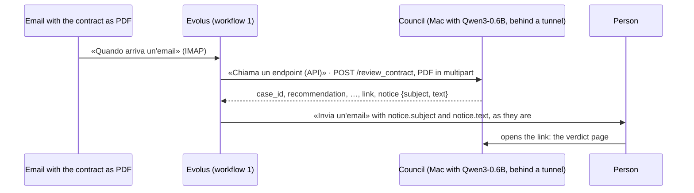

# council/evolus: workflow 1 in Evolus

Code and guide for the Evolus side of the council service (`council/service`).
It is the first slice: from the email with the contract to the notice for the person, **without an agent and without a GPU**.
The whole flow is in `council/FLUSSO.md`; the server is in `council/service`.



The names between «» are the labels of Evolus's Italian interface, as seen in the event workspace on 14/10. They are
kept in Italian so they can be found on screen; an English gloss follows where it helps.

## 0. The server, reachable from Evolus

Evolus wants a public https address and refuses private ones. The server runs on the MI300X, in G1's engine container (`g1/README.md`, step 3), with the image's ROCm torch; an 8 GB Mac cannot hold it.

```bash
# on the MI300X: the main code in ~/hackathon/eval, which is /work/eval in the container
docker exec engine bash -c "cd /work/eval/council/service && python3 -m venv --system-site-packages /root/venv \
    && grep -v '^torch==' requirements.txt > /tmp/req.txt && /root/venv/bin/pip install -r /tmp/req.txt"

# the tunnel: prints https://<name>.trycloudflare.com
cloudflared tunnel --url http://127.0.0.1:8001

# the server, with that name; the same secret goes into Evolus's webhook
export COUNCIL_SECRET=$(openssl rand -hex 32)
NAME=<name>.trycloudflare.com
docker exec -d -e COUNCIL_SECRET -e NAME engine bash -c "cd /work/eval/council/service && \
    /root/venv/bin/python -m reviewer --model Qwen/Qwen3-14B --steps 10 \
    --link https://\$NAME/verdict/{id}?key={key} --public-host \$NAME"
```

`curl https://$NAME/health` must answer `"ready": true`.
A new machine has a new IP and the tunnel a new name: update the URL of the «Consiglio» webhook in Evolus.
The fixed name is in `site/mi300x/README.md`, "The engine's name", still to be configured.

## 1. The automation

«Automazioni» › «+ Nuova automazione» (Automations › New automation): `Consiglio – contratto dall'email`. It stays **«In pausa»** (paused) until the run has been tested.

### «Quando parte» (trigger)

- **«Quando arriva un'email»** (when an email arrives), «Tipo di casella» (mailbox type) **IMAP** (there is also Microsoft 365 with Graph, which needs an app on Azure):
  `imap.gmail.com`, port 993, SSL, user the full address, Google **app password**.
  Google does not give app passwords to newly created accounts: an older account is needed.
- **The contracts mailbox is different from the one that receives the notices**, otherwise every notice would restart the automation.
- **The public address is another Gmail account**, which forwards to `<mailbox>+contratti@gmail.com`, because a new account has no app password:

  ```text
  contract → public address ──forward──▶ <mailbox>+contratti ──filter──▶ «Contratti» folder ◀── Evolus (IMAP)
  ```

  - in the public address: «Inoltro e POP/IMAP» › «Inoltra una copia della posta in arrivo a…» (forward a copy of incoming mail to…), then «Salva modifiche»; a `filename:pdf` filter › «Non inviare mai a Spam», because **Gmail does not forward mail that ended up in spam** and PDFs from new addresses end up there;
  - in the mailbox: a filter with «Contiene le parole» `deliveredto:<mailbox>+contratti@gmail.com` › «Ignora Posta in arrivo», label `Contratti`, «Non inviare mai a Spam». The «A» (To) field does not work: the forwarded email still has the public address as recipient;
  - Evolus reads only **unread** emails: the filter does not mark them as read;
  - whoever tests does not send from the mailbox itself: Gmail drops the copy that comes back.
- «Ogni quanti secondi» (polling interval): 120 by default. «Segna le email come lette» (mark as read) on; «Immagini nel corpo dell'email» excluded.
- «Se arrivano più documenti insieme» (several documents at once): **«Un giro per ogni documento»** (one run per document), because the server reviews one contract per call.
- **«Provala»** (try it) starts the automation by hand even when paused, with an uploaded PDF: it is the first test, without email.

### «Cosa fa» › «Editor a tutto schermo» (actions, full-screen editor)

```text
Trigger ──DOCUMENTO──▶ «Leggi il documento» ──▶ «Chiama un endpoint (API)» ──▶ «Invia un'email»
                       «Solo testo», free «Chiama il Consiglio» «Invia l'avviso al destinatario»
```

The canvas can be built by hand or with **«Costruisci con Evo»**, Evolus's assistant, which adds and connects the blocks.

**In Evolus an endpoint receives only text, never a file** (tested on 16/10):
- the trigger has two outputs, TESTO (the email body) and DOCUMENTO (the attachments); DOCUMENTO connects only to «Leggi il documento» and «Chiama un estrattore dati»;
- «Multipart coi file del flusso» connected to TESTO does not attach the PDF: it sends a form with the text only, empty when starting from «Provala»;
- so the PDF goes through **«Leggi il documento»** (read the document) with the **«Solo testo del documento»** (document text only) reader, free, and the server receives the text in the `body` part of the form. It is the same text the server would read from the PDF; scans stay empty here too.

The other readers (Azure Document Intelligence, GreenPT, «Lascia fare a Evolus») cost 10 credits per page. They are only needed for scanned contracts: that is a later slice.
In «Leggi il documento»: «I documenti sono facoltativi» (documents are optional) off (without a PDF the run stops there, without calling the council), «Salta gli allegati non leggibili» (skip unreadable attachments) on.

### «Chiama il Consiglio» (block «Chiama un endpoint (API)»)

| Field | Value |
|---|---|
| «Metodo» | `POST` |
| «Destinazione» | «Endpoint del catalogo», the catalog connection with address and encrypted secret |
| «Intestazioni (header)» | none: there the value stays in clear text, the secret goes into the catalog connection |
| «Corpo» | «Il risultato del flusso»: the text read from the PDF |
| «Formato di invio» | «Multipart coi file del flusso» |
| «Come leggere la risposta» | JSON |
| «Struttura della risposta (facoltativa)» | `example-response.json`, so the next block offers the fields |

The catalog connection is created from the company menu › «Sviluppatori» › «Webhook» › «Nuovo webhook», and it belongs to the automation's application, otherwise the dropdown does not offer it:

| Field | Value |
|---|---|
| «Nome» | `Consiglio` |
| «URL» | `https://<name>/review_contract` |
| «Header di sicurezza» | `X-Api-Key` |
| «Valore segreto» | `COUNCIL_SECRET`, as is |

The secret lives only there, never in a file of the repo.

- **The contract:** the server takes a PDF (the `contract` field or the first file that is a PDF, even without a name) and, if there is none, the text of the `body` part or of a part without a name, as Evolus sends it. Extra fields are ignored.
- **Sender, subject and date** in the address, if the connection accepts placeholders: `…/review_contract?sender=…&subject=…&date=…`.
  If they are missing, the case is reviewed anyway, with sender "(unknown)" and today's date; the verdict's title is then the contract's first line.
- `mode` stays at its default, `telepathy`.

### «Invia l'avviso al destinatario» (block «Invia un'email»)

| Field | Value |
|---|---|
| recipient | fixed: the person who decides |
| «Rispondi a chi ha scritto» (reply to sender) | **off**: the notice never goes to whoever sent the contract |
| subject | `notice.subject` of the «Chiama il Consiglio» response |
| text | `notice.text` of the same response, as is |

The server writes the notice, in English, with recommendation, flagged clauses, highlighted dissents and the link to the verdict page.
Without an intact seal it asks for a person.

## What it sends and what it receives

- **Sends:** the PDF text in multipart, `sender`, `subject` and `date` in the address.
- **Receives:** `case_id`, `verdict`, `recommendation` {value, rationale}, `flagged`, `major_dissents`, `other_dissents`, `seal_intact`, `link`, `notice` {subject, text}, `mode`, `model`, `tokens_generated`, `seconds` (as in `example-response.json`).
- **Uses:** only `notice.subject` and `notice.text`. The other fields serve the slice with the agent and workflow 2.

Errors: 401 without the secret, 400 with a bad request (for example a scan without text), 500 with a failure. The body is `{"error": "…"}`.

## Call duration and retries

Measured on 16/10 on the MI300X, with Qwen3-14B and a one-page contract:
- **the call takes about 105 seconds and Evolus waits**, without a timeout;
- **the same email is the same case:** the second identical call returns in under a second, with the same `case_id`;
- **Evolus retries by itself after a 500**, several times (after about 2, 11 and 30 seconds); **after a 400 it does not retry**.

## Test without Evolus

```bash
curl -X POST "https://$NAME/review_contract?sender=legal%40acme.example&subject=Contratto%20Acme&date=2026-10-14" \
    -H "Authorization: Bearer $COUNCIL_SECRET" -F "file=@contract.pdf;type=application/pdf"
```

Repeated identically, it returns the same `case_id` right away.

## Still open

- The limit on the mailbox's attachments.
- Where the catalog connection is created and whether its address accepts placeholders.
- The timeout of «Chiama un endpoint» and whether Evolus retries by itself.
- Whether the event workspace has its own MCP connector: it is needed for the next slice.
