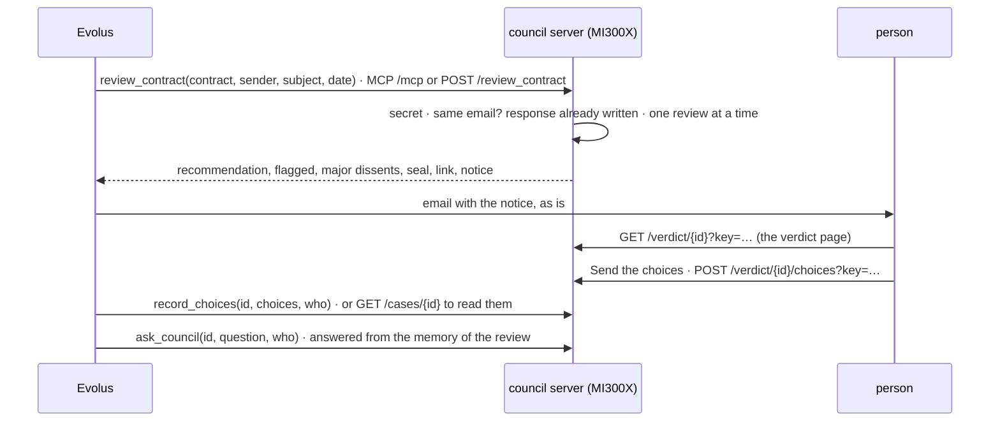

# council/service: the council for Evolus

Code of the "Evolus flow" part of the council.
The server exposes the council with three tools, via MCP and via HTTP, with the same scheme as the Help Desk's server.
This way Evolus talks to both projects in the same way.



| File | What it does |
|---|---|
| `reviewer/manager.py` | the three tools and their rules, the same for MCP and HTTP |
| `reviewer/server.py` | MCP on `/mcp`, the same routes in HTTP, the secret, the person's routes with the link's key |
| `reviewer/routing.py` | with `--long-model`, short contracts to one model and long ones to another |
| `../review/review/visual.py` | the PDF inspector of the visual skill, used by the manager when a PDF arrives |
| `reviewer/memory.py` | the memory of the last reviews, on the GPU, for `ask_council` and the visual checks |
| `reviewer/institution.py` | the institutional memory: playbook and precedents |
| `reviewer/mailbox.py` | the PDF of a contract Evolus sends as text, read from the contracts mailbox |
| `reviewer/__main__.py` | loads the models once, creates the council in telepathy and in text, plugs the visual mode, starts uvicorn |
| `tests/` | tests with a fake council, which returns the page's example review |

## Rules

- **Secret:** every Evolus route requires it, in `Authorization: Bearer <secret>` or `X-Api-Key`.
- **The person's link:** the verdict page and sending the choices use the **case key**, an HMAC of the id made with the secret. Whoever has the link opens only that case, without knowing the secret. With a wrong key or a case that does not exist the answer is always 404.
- **One review at a time**, because there is one GPU.
- **The same email is the same case:** Evolus retrying does not make the council run again.
- **Without an intact seal** there is no verdict: `verdict` is false and the notice asks for a person.
- **The contract** arrives as text, in base64 or as a PDF file in a form. **The text is not saved:** the case keeps review, view, page and choices, plus the contract's fingerprint.
- **A PDF is inspected first** (`council/review/review/visual.py`): rules on the PDF, no model. See [The visual skill](#the-visual-skill).
- **The choices:** for each category in dissent, `expert` or `verdict`, like the two buttons of the page.
- **The notice** (`notice.subject`, `notice.text`) is written in English, like the council's rationale.
- **Errors:** a bad request returns 400 before touching the model; a failure returns 500 without details. Error bodies are `{"error": "…"}`.

## The visual skill

A contract in PDF goes through a deterministic inspector before the council.
One signal is enough to make the PDF complex: a scanned page, raster images large enough for initials, a signature or a stamp (a logo at the same place on almost every page does not count), signature fields and ink, stamp or note annotations, hand-drawn vector strokes, hidden text (white, invisible, off the page or tiny).

| PDF | What the council reads | `route` |
|---|---|---|
| simple | the PDF's text, as before: same case id | `text` |
| complex, visual mode off | the visible text, without the hidden text | `text` |
| complex, visual mode on | the visible text, plus the pages that fired a signal as images, seen by the visual expert at the head of the chain | `visual` |
| scan without text, visual mode off | nothing: 400, a scan needs the visual mode | |

Hidden text is removed from the text of a complex PDF, so a white-on-white instruction does not reach the agents, and the signals give only its reason and length, so it does not reach Evolus's agent through the response either.
Some hiding is not seen (text under an opaque box, dark on dark, clipped away, invisible text on a scan-sized image, kept as its OCR): the limits are in `visual.py`.
A complex PDF whose only signal is hidden text has nothing to look at, so it goes the `text` way even with the visual mode on.
The decision is in the case's `visual.json` and in the response's `visual`: which signals fired and on which pages, the route, whether hidden text was removed, whether the visual mode is on, and `skill_sections`, the sections of the visual skill those signals call for (`signatures`, `stamps`, `handwriting`, `tables`, `scans`; on the `text` route what would have been loaded, `[]` for a simple PDF).
A text contract has neither.

### The visual checks

In the `visual` route the visual expert sees the pages, and right after the review the council answers the fixed questions of the sections the signals call for from the memory of that review (`ask(..., visual=True)`):

| Section | Question |
|---|---|
| `signatures` | Who signed? Which signature blocks are empty? |
| `stamps` | Are there stamps or seals? What do they say? |
| `handwriting` | Are there handwritten corrections, notes or missing initials? What do they change? |
| `tables`, `scans` | none: their content is in the clauses the council read |

The answers go in `visual.checks`, in the response and in `visual.json`: `[{section, question, answer, objects, known}]`, where each object is `{page, type, box_2d, text}` with `box_2d` as `[ymin, xmin, ymax, xmax]` normalized to 0-1000.
A question that fails (the memory is gone, it did not pass the checks, the answer is not valid JSON) has `known: false` and an `error`, and the review stands.
The notice adds at most two lines `Visual check: <answer>`, only for known answers, the signatures first.
The verdict page of a complex PDF shows the same in plain words (how the council read it, why the PDF is complex, the hidden text removed, each check with where its objects are on the page); a simple PDF's page is the one of before.

For a complex PDF the case id hashes the visible text and the route (and, in the visual route, the PDF): the same email sent again after the visual mode is turned on is a new case, not the text-only one already written.

### The visual expert

The visual mode is on when Gemma 4 31B is loaded (`--model` or `--long-model google/gemma-4-31B-it`); the server says "Visual mode on" at start-up.
`visual_review` in `reviewer/__main__.py` skips the router and always uses Gemma 4 31B:

1. the flagged pages are rendered (`render_pages`, longest side 1536 px) and read at 560 soft tokens each: in the probe of 17/10 on the four synthetic PDFs, 560 found what 1120 found (precision 100%, recall 75%), in less time;
2. a **visual expert** heads the review's chain (`Council.review(..., visual=...)`), after the institutional memory: it sees the page images, and its instructions are the **whole** visual skill (`skill_text(SECTIONS)`), the same fixed prompt for every PDF;
3. the legal, finance and risk experts then read the visible text as usual, on top of its memory; the chair writes the verdict;
4. the memory of the review is kept for the visual checks and `ask_council`.

In telepathy the visual expert passes on its memory, which holds the pages themselves; in text mode it writes a report and only that survives.
On PDF A and D of `council/data/vision`, four questions nobody had planned (the seal's shape and ink colour, whether the seal carries a date, what is drawn next to the empty signature field, whether a signature is handwritten) were answered right 4 times in telepathy and once in text, and the telepathy reviews took 88 s and 39 s against 148 s and 82 s.
On the fixed checks (`visual_trial.py` on the four PDFs) the two modes are close: telepathy precision 91%, recall 50%, 92 s per document; text 100%, 45%, 128 s.

A question asked with `ask_council` on a case that went the `visual` way is asked on the pages too (`visual=True`), and the answer carries the objects seen.

## HTTP API

| Route | Auth | Request | Response |
|---|---|---|---|
| `POST /review_contract` | secret | JSON `{text \| pdf_base64, sender, subject, date, mode}`, or a form with the PDF (field `contract` or the first PDF file) or the text (part `body` or unnamed); `sender`, `subject`, `date`, `mode` also as query parameters | `case_id`, `verdict`, `recommendation` {value, rationale}, `seal_intact`, `flagged` [{category, quote, quote_found}], `major_dissents` [{category, expert, expert_confidence, highlighted}], `other_dissents`, `link`, `notice` {subject, text}, `mode`, `model`, `tokens_generated`, `seconds`; only for a PDF, `visual` {complex, signals, visual_pages, route, hidden_text_removed, visual_mode, skill_sections, and in the `visual` route checks} |
| `POST /record_choices` | secret | `{case_id, choices: {category: "expert" \| "verdict"}, who, reasons, corrections, instruction}` | `case_id`, `recorded`, `choices`, `who`, `when`; with the institutional memory, `precedents_added` |
| `POST /ask_council` | secret | `{case_id, question, who}` | `case_id`, `question`, `who`, `when`, `answer` {answer, quote or objects, known}, `stopped`, `memory_bytes`, `seconds` |
| `GET /cases` | secret | | [{case_id, title, recommendation, major_dissents, choices}] |
| `GET /cases/{case_id}` | secret | | `view`, `choices` |
| `GET /verdict/{case_id}?key=…` | link key | | the verdict page |
| `POST /verdict/{case_id}/choices?key=…` | link key | `{choices}` | as `record_choices` |
| `GET /live/contracts` | secret, `--live` | | [{key, title, benchmark, subset}] |
| `POST /live/contract` | secret, `--live` | `{contract: "<benchmark>:<id>", mode}` | as `review_contract`, plus `live`, `contract`, `view`; 409 if busy |
| `GET /health` | open | | `ready`, `review_in_progress`, `live` |

MCP on `POST /mcp` has the tools `review_contract(sender, subject, date, text, pdf_base64, mode)`,
`record_choices(case_id, who, choices, reasons, corrections, instruction)` and `ask_council(case_id, question, who)`.
`mode` is `telepathy` (default) or `text`. `ask_council` answers from the memory of the review, kept on the GPU within
`--memory-gb` (24 by default) and never written to disk: after a restart, or when newer reviews push it out, the
contract must be reviewed again.

## Usage

```bash
cd council/service
uv venv -p 3.12 .venv && uv pip install -p .venv/bin/python -r requirements.txt
.venv/bin/python -m pytest -q          # without a model

export COUNCIL_SECRET=$(openssl rand -hex 32)      # the same goes into Evolus's connector
.venv/bin/python -m reviewer --model Qwen/Qwen3-14B --steps 10 \
    --link "https://council.example.org/verdict/{id}?key={key}" --public-host council.example.org
```

Other flags: `--long-model` and `--threshold` (routing), `--dtype`, `--no-realign`, `--cases`, `--host`, `--port`,
`--ssl-certfile`, `--ssl-keyfile`, `--live dev [test]`, `--with-demo`, `--max-tokens`, `--memory-gb`, `--playbook`,
`--institution`.

The visual mode needs transformers 5.20.1 or later, `pypdfium2` and `pillow` (the probe stops if Gemma ignores the
image budget). On the MI300X it ran with `--model google/gemma-4-31B-it --steps 0 --no-realign --playbook
playbook-example.md`.

### The PDF from the contracts mailbox

Evolus sends only the text of an attachment (see `../evolus/README.md`). With these environment variables the server
reads the PDF from the same mailbox Evolus reads, read-only (`BODY.PEEK`, nothing marked or moved), and picks the
attachment whose words match the text Evolus sent (at least 80% in common), or, for a scan without text, the newest PDF
of the last 15 minutes:

```bash
export COUNCIL_IMAP_USER=contracts@example.org
export COUNCIL_IMAP_PASSWORD=...        # an app password, never in a file of the repo
export COUNCIL_IMAP_FOLDER=INBOX        # the folder Evolus checks
export COUNCIL_IMAP_HOST=imap.gmail.com # default
```

A complex PDF found there goes the `visual` way, and the case says `"pdf_from": "mailbox"`. Without the variables, or
if the mailbox cannot be read, the contract goes the text way as before.

TLS is done by Caddy in front, as for the Help Desk: `caddy reverse-proxy --from council.example.org --to 127.0.0.1:8001`.
The cases live in `~/.council/cases/<id>/`.

## Institutional memory

With `--playbook playbook.md` every telepathy review starts from the council's institutional memory: the company's
playbook and the precedents its people decide.

- **Precedents** are born from `record_choices`: for each category the person chooses on the verdict page, the clause
  should or should not be flagged, with the quote. They are lines of `~/.council/institution/precedents.jsonl`
  (`--institution` to change the folder), with who decided and when. Removing a line removes the precedent.
- The **version** is the hash of playbook and precedents. Each version is read once per model and sealed as **base
  messages** at the head of every review's chain: a changed byte stops the review, as for the experts' messages.
- The response says which memory the review started from: `institution` = version, number of precedents, base
  fingerprints. In text mode there is no memory to pass on: `institution` is `null`.
- `playbook-example.md` is the playbook of a fictional company, for the demo.

## What is missing

- **The Evolus side:** workflow 1 works (email → `review_contract` → notice, checked on 17/10, see `../evolus/README.md`). Still to do: the second workflow with the choices, and the person's questions by reply (`ask_council`).
- **The inspector's limits:** a page without images is never sent, so missing initials on a text-only page are not seen; some hidden text is not detected.
- **The chair's rationale** can be cut by its token cap.
- **Latent steps and realignment** for `--steps` and `--no-realign`: the ones chosen in the calibration, after the diagnosis of 12/10/2026.
