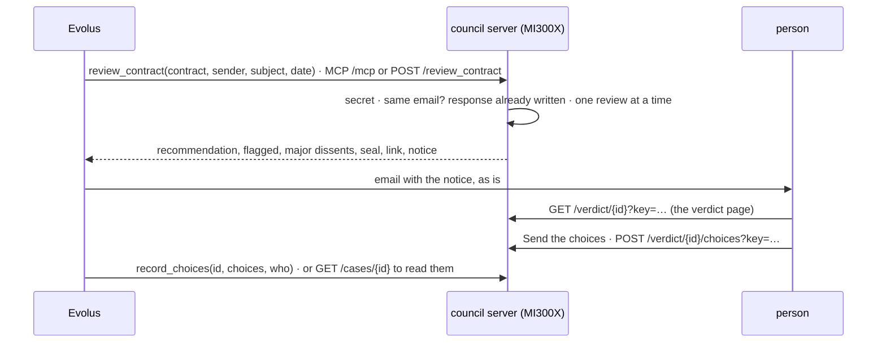

# council/service: the council for Evolus

The "Evolus flow" part of the council.
The server exposes the council with two tools, via MCP and via HTTP, with the same scheme as the Help Desk's server.
This way Evolus talks to both projects in the same way.



| File | What it does |
|---|---|
| `reviewer/manager.py` | the two tools and their rules, the same for MCP and HTTP |
| `reviewer/server.py` | MCP on `/mcp`, the same routes in HTTP, the secret, the person's routes with the link's key |
| `reviewer/routing.py` | with `--long-model`, short contracts to one model and long ones to another |
| `reviewer/__main__.py` | loads Qwen3 once, creates the council in telepathy and in text, starts uvicorn |
| `tests/` | tests with a fake council, which returns the page's example review |

## Rules

- **Secret:** every Evolus route requires it, in `Authorization: Bearer <secret>` or `X-Api-Key`.
- **The person's link:** the verdict page and sending the choices use the **case key**, an HMAC of the id made with the secret. Whoever has the link opens only that case, without knowing the secret. With a wrong key or a case that does not exist the answer is always 404.
- **One review at a time**, because there is one GPU.
- **The same email is the same case:** Evolus retrying does not make the council run again.
- **Without an intact seal** there is no verdict: `verdict` is false and the notice asks for a person.
- **The contract** arrives as text, in base64 or as a PDF file in a form. The PDF's text is read; a scan without text is rejected, because there is no OCR. **The text is not saved:** the case keeps review, view, page and choices, plus the contract's fingerprint.
- **The choices:** for each category in dissent, `expert` or `verdict`, like the two buttons of the page.
- **The notice** (`notice.subject`, `notice.text`) is written in Italian, like the client's verdict page: it goes to an Italian business.
- **Errors:** a bad request returns 400 before touching the model; a failure returns 500 without details. Error bodies are `{"error": "…"}`.

## HTTP API

| Route | Auth | Request | Response |
|---|---|---|---|
| `POST /review_contract` | secret | JSON `{text \| pdf_base64, sender, subject, date, mode}`, or a form with the PDF (field `contract` or the first PDF file) or the text (part `body` or unnamed); `sender`, `subject`, `date`, `mode` also as query parameters | `case_id`, `verdict`, `recommendation` {value, rationale}, `seal_intact`, `flagged` [{category, quote, quote_found}], `major_dissents` [{category, expert, expert_confidence, highlighted}], `other_dissents`, `link`, `notice` {subject, text}, `mode`, `model`, `tokens_generated`, `seconds` |
| `POST /record_choices` | secret | `{case_id, choices: {category: "expert" \| "verdict"}, who}` | `case_id`, `recorded`, `choices`, `who`, `when` |
| `GET /cases` | secret | | [{case_id, title, recommendation, major_dissents, choices}] |
| `GET /cases/{case_id}` | secret | | `view`, `choices` |
| `GET /verdict/{case_id}?key=…` | link key | | the verdict page |
| `POST /verdict/{case_id}/choices?key=…` | link key | `{choices}` | as `record_choices` |
| `GET /live/contracts` | secret, `--live` | | [{key, title, benchmark, subset}] |
| `POST /live/contract` | secret, `--live` | `{contract: "<benchmark>:<id>", mode}` | as `review_contract`, plus `live`, `contract`, `view`; 409 if busy |
| `GET /health` | open | | `ready`, `review_in_progress`, `live` |

MCP on `POST /mcp` has the tools `review_contract(sender, subject, date, text, pdf_base64, mode)` and
`record_choices(case_id, choices, who)`. `mode` is `telepathy` (default) or `text`.

## Usage

```bash
cd council/service
uv venv -p 3.12.venv && uv pip install -p.venv/bin/python -r requirements.txt
.venv/bin/python -m pytest -q # without a model

export COUNCIL_SECRET=$(openssl rand -hex 32) # the same goes into Evolus's connector
.venv/bin/python -m reviewer --model Qwen/Qwen3-14B --steps 10 \
    --link "https://council.example.org/verdict/{id}?key={key}" --public-host council.example.org
```

Other flags: `--long-model` and `--threshold` (routing), `--dtype`, `--no-realign`, `--cases`, `--host`, `--port`,
`--ssl-certfile`, `--ssl-keyfile`, `--live dev [test]`, `--with-demo`, `--max-tokens`.

TLS is done by Caddy in front, as for the Help Desk: `caddy reverse-proxy --from council.example.org --to 127.0.0.1:8001`.
The cases live in `~/.council/cases/<id>/`.

## What is missing

- **The Evolus side:**
  - the workflow that starts from the email and calls `review_contract`;
  - the notice to the person;
  - the second workflow with the choices.

  They are done with the Evolus integration and the Discord answers about the connector's limits.
- **Latent steps and realignment** for `--steps` and `--no-realign`: the ones chosen in the calibration, after the diagnosis of 12/10/2026.
